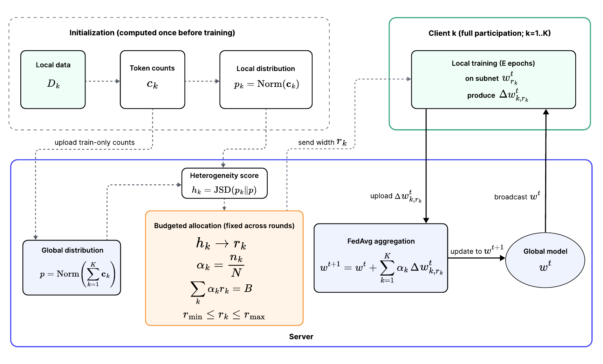

# HASA: Subnet Allocation for Compute-Constrained Model-Heterogeneous Federated Learning

Code for the IEEE EDGE 2026 paper by Amir Hossein Shahdadian, Ahmed M. Abdelmoniem, Mahdi Taheri, Samira Nazari and Christian Herglotz.

[Paper (arXiv:2606.07621)](https://arxiv.org/abs/2606.07621) · [](https://colab.research.google.com/github/Reliable-and-Secure-Systems/HASA/blob/main/notebooks/HASA_demo.ipynb)

In model-heterogeneous federated learning, every client trains a subnet of one shared supernet. Most allocation rules give the wider subnets to clients with more data or more compute. HASA looks at the data instead. It scores each client by how far its training distribution is from the pooled one (Jensen-Shannon divergence, computed from training data only), gives wider subnets to the more heterogeneous clients, and rescales all widths so that the size-weighted compute budget stays fixed. On an article-title next-word prediction benchmark with seven clients, HASA improves mean, worst-client and P10 accuracy over uniform allocation at the same budget.



## Demo

Open the notebook with the Colab badge above, choose a GPU runtime (*Runtime → Change runtime type → T4 GPU*) and run all cells. It clones this repository and runs the article-title experiment of the paper from start to finish:

1. the federation: seven Medium publications, one client each;
2. how different each client's data is (train-only Jensen-Shannon divergence);
3. the HASA widths under a fixed compute budget (Algorithm 1);
4. what a width means inside the slimmable LSTM;
5. federated training with HASA widths and with uniform widths, over the paper's ten seeds;
6. the results, overall and client by client.

Everything takes seconds except training: twenty federated runs of a few minutes each on a GPU (about five minutes each on an Apple-silicon laptop). The paper's experiments ran on an Apple-silicon GPU, and there the runs follow the paper's own runs almost exactly. On other hardware, tiny floating-point differences grow during training, so a single seed can end a few tenths of a point higher or lower, while the ten-seed averages stay close.

To run it locally instead:

```bash
git clone https://github.com/Reliable-and-Secure-Systems/HASA.git
cd HASA
pip install -r requirements.txt
jupyter notebook notebooks/HASA_demo.ipynb
```

## Repository

| Path | Contents |
|---|---|
| `hasa/data.py` | Article-title benchmark: Medium titles, one client per publication, 70/10/20 article-level splits |
| `hasa/method.py` | Train-only heterogeneity score and budgeted width allocation (Algorithm 1), plus the other allocation policies compared in the paper |
| `hasa/model.py` | Slimmable one-layer LSTM (embedding 128, hidden 256) |
| `hasa/train.py` | Federated training with FedAvg, and the selective-aggregation baselines |
| `hasa/report.py` | Tables and figures for results over several seeds |
| `notebooks/HASA_demo.ipynb` | The demo |
| `data/medium_data.csv` | The dataset (see below) |

## Data

`data/medium_data.csv` is the [Medium articles dataset](https://www.kaggle.com/datasets/dorianlazar/medium-articles-dataset) by Dorian Lazar (CC0: Public Domain), included unchanged. Titles are cleaned, lowercased and split into words; the vocabulary and the heterogeneity scores use training articles only.

## Citation

```bibtex
@inproceedings{shahdadian2026hasa,
  title     = {{HASA}: Subnet Allocation for Compute-Constrained Model-Heterogeneous Federated Learning},
  author    = {Shahdadian, Amir Hossein and Abdelmoniem, Ahmed M. and Taheri, Mahdi and Nazari, Samira and Herglotz, Christian},
  booktitle = {2026 IEEE International Conference on Edge Computing and Communications (EDGE)},
  year      = {2026},
  eprint    = {2606.07621},
  archivePrefix = {arXiv}
}
```

## License

MIT, see `LICENSE`.
